<p align="center">
  
</p>

<p align="center">
  
  
  
</p>

<p align="center">
  <a href="#o-que-é">O que é</a> ·
  <a href="#como-funciona">Como funciona</a> ·
  <a href="#os-três-jeitos-de-começar">Como começar</a> ·
  <a href="#perguntas-frequentes">Perguntas</a> ·
  <a href="#instalação"><b>Instalação</b></a>
</p>

## O que é

O Forge é um plugin para o [Claude Code](https://claude.com/claude-code) que transforma uma
conversa em uma pequena equipe de software.

Você fala com **um único** agente, o **orquestrador**. Ele entende o pedido, divide o trabalho
em tarefas e chama o especialista certo para cada uma. A mesma pessoa não faz tudo: quem
escreve o código nunca é quem confere se ficou certo.

> **Em uma frase:** é como um mestre de obras que não pega no martelo. Ele planeja e
> distribui o trabalho, e só considera a obra entregue depois que o fiscal aprova.

## Como funciona

<p align="center">
  
</p>

| Quem | O que faz | Pense nele como |
|---|---|---|
| **Orquestrador** | Conversa com você, escreve a spec, divide em tarefas e distribui. Não escreve código. | o mestre de obras |
| **`dev`** | Escreve todo o código e roda build e testes unitários. | o construtor |
| **`tester`** | Confere a entrega no navegador real ou por contrato (API, CLI, MCP server, infra) e dá o veredito: `PASSOU`, `FALHOU` ou `BLOQUEADO`. | o fiscal |
| **`scout`** | Lê, pesquisa e mapeia em volume, e volta só com o resumo. | o batedor |

Se o `tester` reprova, a tarefa volta para o `dev` com o defeito descrito. O ciclo só fecha
com `PASSOU`.

### As regras não dependem de boa vontade

<p align="center">
  
</p>

Uma instrução escrita pode ser esquecida no meio de uma conversa longa. Por isso as regras
que mais importam são **hooks**, scripts que o Claude Code roda antes e depois de cada ação:

- se o orquestrador tenta escrever código, ele é **bloqueado** e precisa delegar ao `dev`;
- quando o `dev` entrega algo que dá para verificar (tela, API, comando para subir), um hook
  marca a validação como **pendente** e cobra o `tester` antes de fechar a tarefa;
- cada papel tem um **teto de turnos**: ao chegar nele, o subagente devolve o que já fez e o
  orquestrador continua de onde parou;
- um `commit` só sai com identidade git configurada no próprio repositório.

O `/forge:setup` grava o resto das regras no `CLAUDE.md` do seu repositório. Entre elas:
nada de `git push` ou deploy sem ordem sua, commits em português e tarefas independentes
rodando em paralelo.

## Os três jeitos de começar

Digite `/forge` e escolha um caminho:

| | Caminho | Quando usar | Termina em |
|:-:|---|---|---|
| **1** | **Criar do zero** | "quero um app que..." | projeto novo, com spec, tarefas e código validado |
| **2** | **Fix / implementação** | bug ou feature num projeto que já existe | mudança validada pelo `tester` |
| **3** | **Investigar / analisar** | incidente, banco de dados, custo, infraestrutura | relatório, sem nenhuma linha de código escrita |

Atalhos: `/forge:new` vai direto para o caminho 1 e `/forge:fix`, para o 2.

<details>
<summary><b>Exemplo: como fica uma conversa do começo ao fim</b></summary>
<br>

Pedido: *"quero uma API de lista de tarefas com login"*.

1. O orquestrador faz algumas rodadas curtas de perguntas e marca cada decisão que tomou por
   conta própria, para você revisar.
2. Gera a spec (`prompt.md`) com critérios de aceite e **mostra para você aprovar**.
3. Divide em tarefas pequenas e despacha o `dev`, com várias ao mesmo tempo quando uma não
   depende da outra.
4. Cada entrega passa pelo `tester`, e o que falhar volta para o `dev`.
5. O progresso fica anotado em `.forge/`, então dá para parar hoje e retomar amanhã.

Nada vai para o GitHub ou para a nuvem sem você pedir.

</details>

## Feito para economizar token

Num loop de agentes, o maior custo é o **contexto reenviado**: a cada turno, a conversa inteira
volta para o modelo. O Forge ataca isso de três formas:

- **`scout` descartável:** a varredura acontece no contexto dele, só o resumo volta, e o resto
  é descartado quando ele termina.
- **Teto de turnos por papel:** nenhuma invocação cresce sem limite.
- **Aviso de leitura:** se o orquestrador começa a abrir arquivo atrás de arquivo, um hook
  sugere passar a tarefa ao `scout`.

O ganho varia de projeto para projeto. Para medir o seu, use o `forge-tokens`, como explica a
[`docs/linha-de-base.md`](docs/linha-de-base.md).

## Perguntas frequentes

<details>
<summary><b>Preciso do Chrome?</b></summary>
<br>

Só se você quiser que o `tester` valide interface no navegador real (modo `browser`, pela
extensão `claude-in-chrome`). Sem ela, o modo `contrato` valida API, CLI, MCP server e
infraestrutura normalmente.

</details>

<details>
<summary><b>Funciona com qualquer nuvem e qualquer stack?</b></summary>
<br>

Sim. Nada depende de um provedor específico, e a regra de deploy é genérica. Em projeto novo,
o `dev` usa por padrão React + Vite + TypeScript e Express + TypeScript com `pnpm`. Em projeto
que já existe, ele segue o stack do repositório.

</details>

<details>
<summary><b>Repositório atual ou fábrica?</b></summary>
<br>

- **Repositório atual:** instale o plugin e rode `/forge:setup` dentro do repositório onde você
  já trabalha. O controle fica em `.forge/`.
- **Fábrica:** uma pasta base com `projects/` dentro. Cada projeto vive em `projects/<nome>/`,
  com git próprio, e você conversa sempre com um orquestrador na raiz. O `/forge:setup`
  oferece criar essa estrutura.

O Forge detecta sozinho em qual dos dois modos está.

</details>

<details>
<summary><b>O <code>rtk</code> é obrigatório?</b></summary>
<br>

Não. O [`rtk`](https://github.com/rtk-ai/rtk) comprime a saída dos comandos de terminal, e o
`/forge:setup` oferece instalar. Sem ele, os hooks continuam funcionando.

</details>

<details>
<summary><b>Dá para ajustar os tetos de turnos?</b></summary>
<br>

Sim, por variável de ambiente (`FORGE_TURN_CAP`, `FORGE_TESTER_CAP`, `FORGE_SCOUT_CAP`…). Os
valores padrão e os avisos estão na [referência técnica](docs/referencia.md#economia-de-token).

</details>

<details>
<summary><b>Para que serve o <code>forge-frontend</code>?</b></summary>
<br>

São 10 skills de interface que o `dev` consulta: TypeScript, React, Tailwind, responsividade,
dark mode, animações, performance, design de UI e conteúdo. Instale só se você trabalha com
front-end. Quem mexe com API, CLI, dados ou infra não precisa, e assim não paga o contexto
delas.

</details>

## Para ir mais fundo

| Documento | O que tem |
|---|---|
| [`docs/tutorial.md`](docs/tutorial.md) | passo a passo do dia a dia, com exemplos de pedido |
| [`docs/referencia.md`](docs/referencia.md) | papéis, hooks, invariantes, tetos de turnos, estrutura e testes |
| [`docs/forge-para-a-equipe.md`](docs/forge-para-a-equipe.md) | o que é, por que existe e como adotar numa equipe |
| [`docs/linha-de-base.md`](docs/linha-de-base.md) | como medir o seu consumo de token antes e depois |

## Instalação

<p align="center">
  
</p>

### 1. Confira os pré-requisitos

- [Claude Code](https://claude.com/claude-code) instalado.
- `python3` e `bash` no `PATH`. Os hooks usam só a biblioteca padrão.
- `git`. Para criar ou mexer em projeto JavaScript, também `node` com `pnpm`.
- Opcionais: [`rtk`](https://github.com/rtk-ai/rtk) e a extensão `claude-in-chrome`.

### 2. Instale o plugin (uma vez por máquina)

Dentro do Claude Code:

```text
/plugin marketplace add MatheusRibeir098/forge-claude
/plugin install forge@forge-claude
```

Se você trabalha com interface, instale também o complemento:

```text
/plugin install forge-frontend@forge-claude
```

<details>
<summary>Prefere o terminal? O mesmo pela linha de comando</summary>
<br>

```bash
claude plugin marketplace add MatheusRibeir098/forge-claude
claude plugin install forge@forge-claude
claude plugin install forge-frontend@forge-claude   # opcional
```

</details>

> [!TIP]
> Se o `/forge` não aparecer na lista de comandos, reinicie a sessão do Claude Code.

### 3. Prepare o repositório (uma vez por repositório)

Abra o Claude Code **na raiz** do repositório onde você vai trabalhar e rode:

```text
/forge:setup     # grava as permissions e as regras no CLAUDE.md (mostra o diff e pede confirmação)
/forge:doctor    # confere se está tudo certo; só lê, não altera nada
```

### 4. Comece

```text
/forge
```

> [!WARNING]
> Abra a sessão sempre na raiz, do repositório preparado ou da fábrica, e nunca direto dentro
> de `projects/<nome>/`. Ali não existem o `CLAUDE.md` nem as permissions do Forge, e não há
> garantia de que os hooks disparem.

### Atualizar e remover

```bash
claude plugin marketplace update forge-claude   # busca a versão nova do catálogo
claude plugin update forge@forge-claude         # atualiza o plugin; depois reinicie a sessão
claude plugin uninstall forge@forge-claude      # remove
```

## Licença

MIT, em [`LICENSE`](LICENSE).
